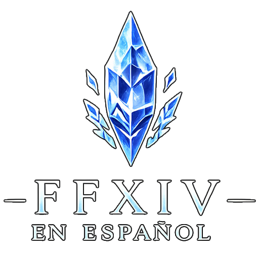
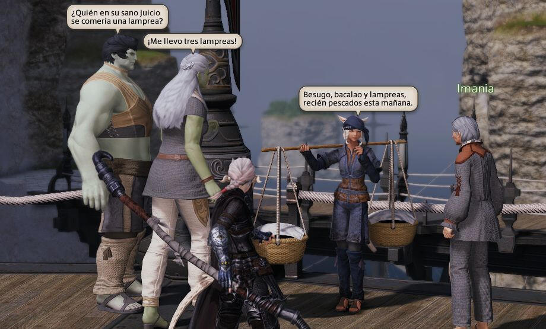

# FFXIV en Español — traducción de Final Fantasy XIV

<p align="center">
  
</p>

Mod de traducción al español para **Final Fantasy XIV** (FF14): interfaz e historia, dentro del
juego. Proyecto no oficial y sin relación con Square Enix.

Web del proyecto: <https://ffxivspanish.carrd.co/>

<p align="center">
  
  
</p>

## Instalar la traducción

Las dos opciones necesitan Final Fantasy XIV con Dalamud y Penumbra.

### Opción recomendada: plugin de Dalamud

El plugin **FFXIV Spanish Translation Manager** genera la traducción dentro del juego, la instala en
Penumbra y la regenera solo cuando cambia el juego o llega una versión nueva.

1. En el juego, abre `/xlsettings` → **Experimental** → **Custom Plugin Repositories** y añade:

   ```text
   https://raw.githubusercontent.com/JadeArkadian/FFXIV-Spanish-Patcher/main/dalamud/pluginmaster.json
   ```

2. Abre `/xlplugins`, busca **FFXIV Spanish Translation Manager** e instálalo.
3. Escribe `/ffxives`, pulsa **Instalar traducción** y reinicia el juego cuando lo pida.

La guía completa, con categorías, actualizaciones y solución de problemas, está en
[`docs/PLUGIN.md`](docs/PLUGIN.md), y sus preguntas frecuentes en
[`docs/PLUGIN_FAQ.md`](docs/PLUGIN_FAQ.md).

### Opción clásica: patcher de escritorio

Aplicación independiente para Windows, Linux y macOS. Genera un `.pmp` que importas tú en Penumbra,
y hay que repetir el proceso con cada versión nueva. Sus instrucciones están en la sección
siguiente.

## Cómo funciona

El proyecto crea un mod de Penumbra con la traducción usando los archivos de tu propia instalación
del juego. No modifica los archivos originales de FFXIV y no incluye archivos del juego: extrae solo
los datos necesarios y les aplica las traducciones incluidas en el programa.

Hay dos formas de usarlo: un **plugin de Dalamud**, que instala y mantiene la traducción por ti, y
el **patcher de escritorio**, que genera un paquete `.pmp` para importarlo a mano. Las dos producen
el mismo mod.

## Avance del proyecto

La traducción todavía está en progreso. Gran parte de la interfaz, nombres de personajes, NPC,
monstruos, objetos y textos del sistema ya está traducida, pero parte del guion, conversaciones y
prosa narrativa puede seguir en inglés.

Datos del seguimiento EXD actual. El porcentaje principal mide líneas traducidas reales sobre líneas
traducibles exactas.

| Métrica | Valor | Avance |
| --- | ---: | --- |
| Avance total por líneas | 659.014/827.118 (79,7%) |  |
| Hojas OK | 5.673/7.024 (80,8%) |  |

El desglose por expansión agrupa misiones, cinemáticas y conversaciones con NPC. La interfaz, los
objetos, el combate, los sistemas y el contenido narrativo que abarca varias expansiones se reúnen
en **Elementos comunes**, sin contarlos de nuevo en cada expansión.

| Icono | Contenido | Líneas traducidas | Avance |
| :---: | --- | ---: | --- |
|  | **A Realm Reborn** | 38.897/38.897 (100,0%) |  |
|  | **Heavensward** | 25.268/25.268 (100,0%) |  |
|  | **Stormblood** | 31.661/31.664 (100,0%) |  |
|  | **Shadowbringers** | 44.094/44.105 (99,0%) |  |
|  | **Endwalker** | 2/47.150 (0,0%) |  |
|  | **Dawntrail** | 2.654/43.016 (6,2%) |  |
|  | **Evercold** | — (progreso desconocido) |  |
| — | **Elementos comunes** | 516.438/597.018 (86,5%) |  |

Evercold todavía no se ha publicado. Se muestra al 0 % hasta que exista contenido con el que medir
su progreso real.

## Patcher de escritorio

### Descargar

Ve a la página de **Releases** del proyecto y descarga el ZIP de tu sistema:

- `FFXIVSpanishPatcher-...-win-x64.zip` para Windows.
- `FFXIVSpanishPatcher-...-linux-x64.zip` para Linux.
- `FFXIVSpanishPatcher-...-osx-arm64.zip` para macOS (Apple Silicon).

Descomprime el ZIP y ejecuta `FFXIVSpanishPatcher`.

No hace falta instalar .NET ni ningún runtime aparte: el programa viene empaquetado como ejecutable
autónomo.

#### Verificar descarga

Cada ZIP publicado incluye un fichero `*.zip.sha256` con su hash SHA-256. Descarga ambos ficheros
en la misma carpeta y comprueba que coinciden:

```powershell
# Windows PowerShell
Get-FileHash .\FFXIVSpanishPatcher-...-win-x64.zip -Algorithm SHA256
```

```bash
# Linux
sha256sum -c FFXIVSpanishPatcher-...-linux-x64.zip.sha256

# macOS
shasum -a 256 -c FFXIVSpanishPatcher-...-<plataforma>.zip.sha256
```

En Windows, compara el resultado con el hash del fichero `.sha256` de la misma release. Las builds
Windows también llevan una firma autofirmada de FFXIVSpanish Patcher: permite detectar alteraciones,
pero no sustituye un certificado emitido por una CA. Usa el SHA-256 como verificación principal.

### Requisitos

- Final Fantasy XIV instalado.
- Penumbra instalado y funcionando en Dalamud.
- Una instalación legible de FFXIV. La versión recomendada ofrece la cobertura más completa.

Cada release se prepara para una versión concreta de FFXIV. La aplicación muestra esa referencia y
la compara con la instalación seleccionada. Si son diferentes, no decide cuál es más antigua ni
bloquea la prueba: muestra un aviso y pide confirmación antes de aplicar un parcheo *best effort*.

En ese modo, las hojas, páginas y líneas que no existan se omiten y se contabilizan. Si queda
contenido válido, el resultado aparece como **Mod verificado con omisiones**; si no puede aplicarse
nada, no se crea un paquete vacío. Consulta la consola para conocer la cobertura exacta.

### Crear el mod

1. Abre `FFXIVSpanishPatcher`.
2. Si detecta la instalación de FFXIV, la ruta aparecerá automáticamente.
3. Si no la detecta, pulsa **Selecciona FFXIV** y elige la carpeta del juego.
4. En **Opciones avanzadas y categorías** (abierto de inicio) decide qué categorías quedarán activadas al
   importar en Penumbra. El paquete siempre incluye traducción completa; debe quedar al menos una
   categoría marcada.
5. Pulsa **Crear traducción para Penumbra**.
6. Si la versión difiere, revisa el aviso y decide si quieres generar *best effort*.
7. Cuando termine, abre la carpeta de salida desde la propia aplicación.

La integridad se comprueba siempre antes de publicar el fichero. Un error de verificación deja el
paquete anterior intacto y se refleja tanto en el resultado como en la consola.

El archivo generado tendrá un nombre parecido a:

```text
FFXIVSpanish-2026-06-24_18-30-00.pmp
```

Por defecto se guarda en:

```text
Documentos/FFXIVSpanish Patcher/Output
```

### Instalar en Penumbra

1. Abre Penumbra dentro del juego.
2. Importa el `.pmp` generado por el parcheador.
3. Activa el mod en colección **Base/Default** y marca las categorías que quieras aplicar.
4. En los ajustes de Dalamud, activa **Wait for plugins before game loads**.
5. Reinicia el juego.

Ese ajuste es importante: si Dalamud carga tarde, Penumbra puede no aplicar el mod a tiempo y verás
el juego sin traducir. Cuando puede localizar Dalamud y Penumbra, el patcher comprueba este ajuste. Si
está desactivado, ofrece activarlo y explica exactamente qué propiedad modificará. Si la detección o
la escritura fallan, continúa sin mostrar errores relacionados con herramientas externas.

### Actualizar o quitar el mod

Cuando salga una release nueva:

1. Descarga el nuevo parcheador.
2. Genera un `.pmp` nuevo.
3. Quita o desactiva el paquete anterior en Penumbra.
4. Importa y activa el paquete nuevo.

Después de un parche oficial de FFXIV, desactiva el mod antiguo hasta que haya una versión nueva de
este proyecto.

## Preguntas frecuentes y solución de problemas

Cada forma de instalar la traducción tiene sus preguntas frecuentes:

- **Plugin**: [`docs/PLUGIN_FAQ.md`](docs/PLUGIN_FAQ.md).
- **Patcher**: [`docs/PATCHER_FAQ.md`](docs/PATCHER_FAQ.md).

Si el juego sigue en inglés, se cierra o tus macros dejan de funcionar, la respuesta es la misma con
las dos: [Problemas en el juego](docs/PATCHER_FAQ.md#problemas-en-el-juego).

## Qué se traduce

La aplicación permite activar o desactivar bloques de traducción:

- Misiones.
- Nombres de NPC, enemigos, lugares y términos del mundo.
- Clases y jobs.
- Objetos.
- Objetos de evento.
- Coleccionables.
- Acciones, habilidades, rasgos y estados.
- Logros.
- Registro de combate y mensajes del sistema.
- Interfaz.

Algunos textos pueden seguir en inglés aunque la categoría esté marcada. Eso suele significar que esa
parte aún no está traducida o que el juego cambió el dato en un parche reciente.

## Avisar de errores

Si encuentras bugs, textos mal colocados, traducciones raras o inconsistencias, puedes enviarlo aquí:

https://tally.so/r/1ARKzp

Lo más útil es incluir:

- Captura del texto.
- Zona, misión, NPC, objeto o menú donde aparece.
- Qué esperabas ver.
- Versión del juego y versión del parcheador.

## Seguridad y límites

- Ni el plugin ni el parcheador tocan los archivos originales del juego.
- La traducción se instala como cualquier otro mod de Penumbra.
- No se redistribuyen archivos de Square Enix.
- El proyecto no está afiliado a Square Enix.
- Usar mods en FFXIV depende de herramientas externas y queda bajo tu responsabilidad.

Lee también `NOTICE.md` para los avisos legales completos. Si quieres contribuir código,
documentación o traducciones, revisa `CONTRIBUTING.md`; las contribuciones asistidas por IA se rigen
además por `AI_USAGE.md`.

## Compilar desde código

Para desarrollo necesitas el SDK indicado en `global.json`. El plugin se compila contra los
ensamblados de Dalamud: hace falta tener XIVLauncher con Dalamud instalado o definir `DALAMUD_HOME`
con una copia de su distribución.

```bash
dotnet restore --locked-mode
dotnet build -c Release --no-restore
dotnet test -c Release --no-build
```

Para publicar un ejecutable autónomo de Windows:

```powershell
dotnet publish src/FFXIVSpanishPatcher.App/FFXIVSpanishPatcher.App.csproj -c Release -r win-x64 `
  --self-contained -p:PublishSingleFile=true -p:IncludeNativeLibrariesForSelfExtract=true
```

El diseño técnico está en `docs/DESIGN.md`, la guía del plugin en `docs/PLUGIN.md`, las preguntas
frecuentes en `docs/PATCHER_FAQ.md` y `docs/PLUGIN_FAQ.md`, la política
*best effort* en `docs/COMPATIBILITY.md`, la edición del historial en `docs/TRANSLATION_MILESTONES.md` y la
validación de releases en `docs/RELEASE_CHECKLIST.md`.
